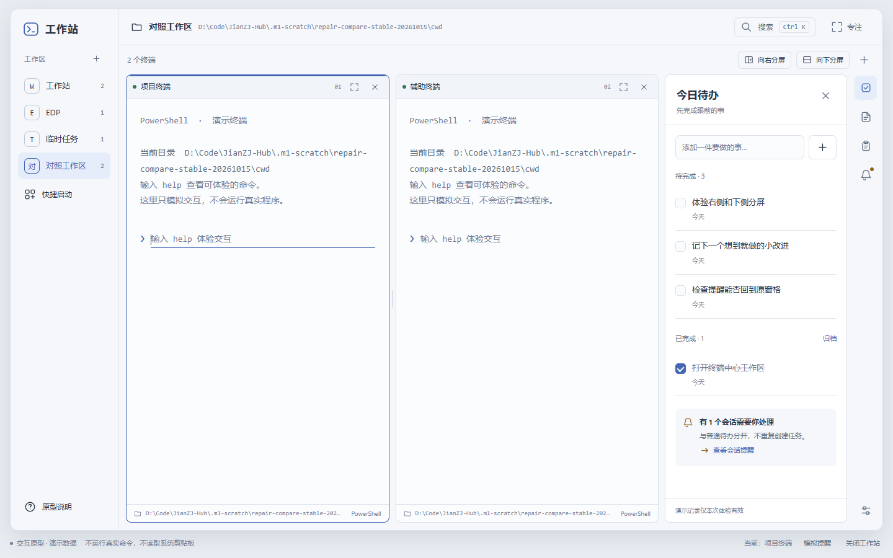
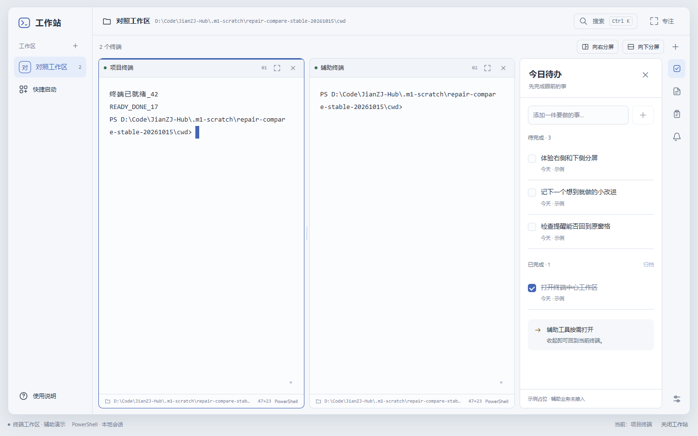

# M1 返修 · 同条件原型／应用对照

> **最新默认口径和程序已更新**：打开即终端、项目可选、辅助默认收起。请以 [BASH-TUI.md](BASH-TUI.md) 的新EXE/截图为准；下文保留上一轮历史口径与证据，不作为本轮人工通过声明。

本页是**对照与差异说明，不是本人视觉验收通过**。对应新包 `2026-10-15T12-32-44-711Z-539df676`；原型仍是 SHA-256 `1033c2dab321312f09ac220450d2fea7fbbf0f905ade18c450a5ed1281e6917a` 的原文件，未修改HTML。

## 对照条件

- 同一机器和 Electron/Chromium；分别按顺序打开认可原型和实际正式 EXE，非探针产品页。
- 相同“新建左右工作区”流程、同名同路径；两者该流程均为50/50。另留原型初始58/42演示图，不把不同状态混为布局偏离。
- 内容区分别 **1440×900** 和 **1424×921**，不是只匹配外窗；DPR=1、页面缩放=1、字体加载完成、14px、舒适密度。
- 显式浅色/深色；设置控件与终端同主题。最终截图等待控件实际背景达到目标颜色，避开150ms颜色过渡。
- 测试实例临时禁用 Chromium 后台绘制/计时节流，以免被遮挡时探针等待停顿；未改Windows显示/主题设置、产品默认启动参数、CSP或ASAR。所有原型和应用测试Job结束后为空。
- 原型是HTML演示文本，应用是实际PowerShell；应用的就绪文本来自真实命令计算，不用原型预置输出冒充终端。

[完整测量、场景和清理原件](evidence/repair-20261015/runtime/repair-compare-stable-20261015/report.json)。

## 1440×900 内容区 · 浅色

**认可原型：**

**本次实际正式包：**

## 1440×900 内容区 · 深色

[原型深色](evidence/repair-20261015/runtime/repair-compare-stable-20261015/prototype-1440-matched-dark.png) · [应用深色](evidence/repair-20261015/runtime/repair-compare-stable-20261015/application-1440-matched-dark.png)

## 设置

[原型设置](evidence/repair-20261015/runtime/repair-compare-stable-20261015/prototype-1440-settings-light.png) · [应用设置](evidence/repair-20261015/runtime/repair-compare-stable-20261015/application-1440-settings-light.png)

两者窗口内设置框实际宽 **540px**、高 **527.8125px**、位置 **x450/y186.09375**。已恢复行说明、滑杆读数和三行预览的结构；真实偏好保存说明不再塞入长路径/大段开发文字，配置位置和CLI作用域在原有“使用说明”中。

## 1424×921 内容区（对应1440×960外窗）

[原型浅色](evidence/repair-20261015/runtime/repair-compare-stable-20261015/prototype-1424-matched-light.png) · [应用浅色](evidence/repair-20261015/runtime/repair-compare-stable-20261015/application-1424-matched-light.png)

[原型深色](evidence/repair-20261015/runtime/repair-compare-stable-20261015/prototype-1424-matched-dark.png) · [应用深色](evidence/repair-20261015/runtime/repair-compare-stable-20261015/application-1424-matched-dark.png)

[原型设置](evidence/repair-20261015/runtime/repair-compare-stable-20261015/prototype-1424-settings-light.png) · [应用设置](evidence/repair-20261015/runtime/repair-compare-stable-20261015/application-1424-settings-light.png)

此条件下新包两个真实终端均为 **46×24**，底栏、xterm、FitAddon建议、PTY与Shell一致。没有靠缩小字体或仅改底栏数字“扩容”。

## 分类与处理

| 项目 | 量测/观察 | 分类与结果 |
|---|---|---|
| 主区/侧栏/抽屉比例 | 两者侧栏174px、抽屉294px；1440内容区终端主区859×723.40625px，1424内容区843×744.40625px | **原型本来如此**：原先外框已一致，保留，不另设计 |
| 顶栏、工具栏、间距与留白 | 顶栏58px、工具栏47px、外侧16/14px、终端与抽屉gap10px、工具轨47px | **原型本来如此**：保持原值 |
| 字体、字号、行高、颜色 | 14px不变，同一字体栈/同源palette；旧xterm31px行格偏离原型25.9px，现设备格26px | **实现偏离已修**：校准语义与取整，不缩字。0.1px为设备网格差异 |
| 终端内边距 | 原型22px 22px 18px；旧应用20px 20px 12px | **实现偏离已修**：恢复原值及原断点padding |
| 边框、焦点、标签和底栏 | 边框/圆角/焦点色保持；序号01/02、工作区启动目录、Shell信息恢复；尺寸状态实时同步 | **实现偏离已修**；真实运行/退出状态及尺寸读数是必要运行信息，不另加入口 |
| 辅助抽屉 | 原先大段开发说明和空态；现按原型待办行/卡片/输入密度展示简洁静态示例，底栏明确未接入，动作禁用 | **实现偏离已修**：不是M2业务；没有伪造可处理的真实提醒、剪贴板或已保存记录 |
| 设置入口/排版 | 仍只有右侧入口；控件说明、滑杆读数、预览与键盘说明恢复 | **实现偏离已修**：范围/路径说明移入已有说明入口 |
| 导航内容与默认会话 | 原型有预置三个项目/演示会话；实际只有本人配置的工作区，重启不启动会话 | **真实产品必要差异**：沿用已确认不恢复/不重放，不生成假项目或进程凑图 |
| 终端正文、光标、滚动条 | 原型普通文本/输入框；实际PTY输出、xterm整单元格、14px预留滚动条、光标/选择 | **真实终端必要差异**：不能用HTML输入框冒充；单元格按设备像素取整，长行依真实列数换行 |
| 目录底栏语义 | 展示工作区启动目录，而非声称已跟踪Shell内每次cd | **必要的诚实标注**：本轮未实现实时cwd跟踪 |
| 通知未读点/提醒卡 | 原型有模拟未读事件，实际尚未接可靠事件源 | **必要差异**：不把假提醒计为真实待处理；不抢焦点、不自动进入M4 |

### 字体不只看配置名

本轮另对**实际xterm已绘制的文本节点**查询 Chromium platform fonts：英文提示行使用 **Consolas（46字形）**，实际中文节点使用 **Microsoft YaHei（4字形）**。配置中列出的Cascadia名称不等于已安装或实际使用。见 [真实终端字形原件](evidence/repair-20261015/runtime/repair-font-check2-20261015/actual-fonts.json) 与 [实际文本截图](evidence/repair-20261015/runtime/repair-font-check2-20261015/actual-fonts.png)。父容器没有直接文本时平台字体API可能返回空列表；本次使用实际含文本的终端行/中文字形span，而非另造同字体预览推断。此结果仍不替代本人在常用输入法/显示缩放下的体验。

## 已修复与仍待本人判断

外框无需重排；列出的实现偏离已修并有对应截图/量测。**是否恢复了本人认可的观感仍需再次人工确认**，不以结构尺寸相同替代视觉接受。

真实IME、人工Ctrl+C、复制粘贴/鼠标选择、长日志阅读/历史重排、实际全屏程序、真实Windows跟随系统主题与不同物理DPI均待验。测试仅证明本机DPR=1的截图/网格及规则计算，不宣称完全复刻iTerm或所有终端程序已兼容。
