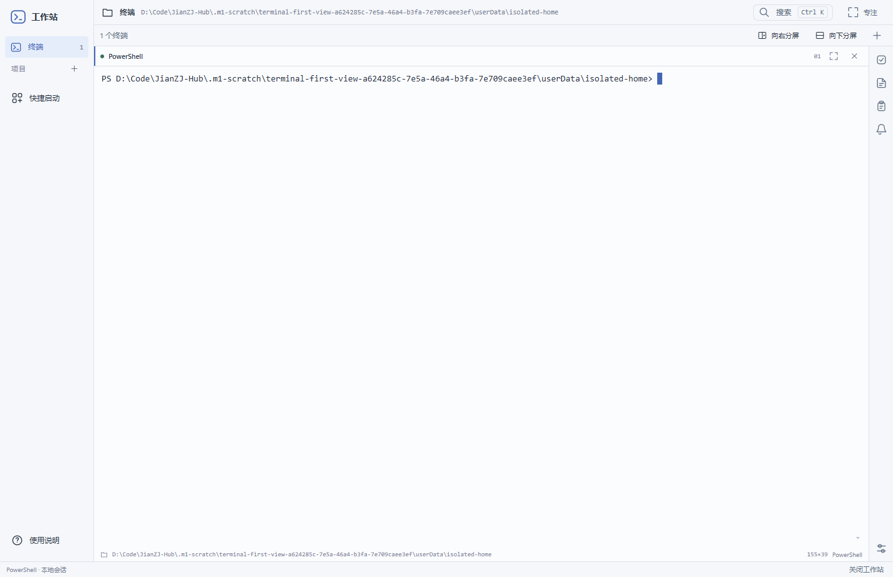

# M1 · 打开即终端（2026-10-16）

> 本文保留上一轮外观/PowerShell交付历史。最新已恢复原型式外壳、改用Git Bash并实测Claude两种TUI，见 [BASH-TUI.md](BASH-TUI.md)；打开即用、项目可选的决定仍保留。

**用户已确认新的默认口径：打开即新终端、项目可选、辅助默认收起。** 这一轮明确取代之前“启动必须先选工作区”和“默认展开示例待办”的做法；外观按终端优先调整，不再将逐像素维持旧原型当作本轮目标。仍在 M1，等待本人体验，不宣称全部验收通过。

## 本次打开的 EXE

```text
D:\Code\JianZJ-Hub\release\m1\2026-10-15T16-12-01-478Z-389afb33\win-unpacked\Workstation.exe
```

[打开程序](../../release/m1/2026-10-15T16-12-01-478Z-389afb33/win-unpacked/Workstation.exe) · [完整 ZIP](../../release/m1/2026-10-15T16-12-01-478Z-389afb33/Workstation-M1-win32-x64.zip)

请关闭旧版后打开这个新路径，不要继续打开 `12-32-44-711Z-539df676` 或更早版本。旧目录与用户配置未覆盖。ZIP 请完整解压，EXE 不能脱离 resources/DLL 单独运行。包仍未签名、无安装器、未上传。

| 产物 | SHA-256 |
|---|---|
| Workstation.exe | `320372296da37bb5ff471c2d517adccc2f001a958633d8ccc1504d4a512854cd` |
| resources/app.asar | `36fc84290b431c3a9ebda6286a96efffc22069761d50f970d5db5889109b780e` |
| ZIP（170,033,411 字节） | `a3fc70d2bb48dbdad948cf06e9593782d0cea3a0a59e8a0154e708a416b71408` |

[产物清单](evidence/terminal-first-20261016/package-manifest.json)。

## 现在的实际行为

- **打开应用直接创建一个全新的 PowerShell，并把输入焦点交给它。** 默认 cwd 为用户主目录；无需点击选择项目、填写路径或命名。测试用进程隔离主目录，截图中的长路径不是产品写死的默认目录。
- 普通“终端”是本窗口的临时归属，由主进程生成合法 ID/目录，不写为持久化项目，也不允许 renderer 任意指定 cwd/exec/env。
- 左侧“项目”仅组织用户自愿保存的目录。选择项目不结束普通终端；可回切。已有项目配置不会在启动时自动运行。
- “新建终端”按钮或 **Ctrl+Shift+T** 无表单直接创建；已有当前终端时用现有右分屏，空间不足明确提示。关闭最后一个窗格后只留轻量“新建终端”动作，不出现项目门槛，不擅自立即补开。
- 辅助默认收起；不会启动时展示静态待办。用户主动打开后才显示明确演示内容，专注恢复只处理本次曾打开的工具。
- **重新打开=新建一个 home Shell，不是恢复旧 Shell、运行树、输出或命令。** 这项新启动行为已获确认，不再沿用旧版“启动0会话”断言。
- 窗口 × /底部关闭仍先确认并结束受管理会话。不做托盘后台常驻、不自动运行 Claude 或其他任务。

## 外观与 WezTerm 实测参照

去除外层浮起卡片、阴影、宽边距和大引导页；终端改为连续平直面，保留紧凑项目栏与唯一工具/设置入口。顶栏40px、动作栏34px、pane头/底32/23px；侧栏150px，终端padding10/12px。字体**仍是14px**，没有缩字来换列数。舒适密度目标1.35×字号、紧凑1.25×字号；DPR=1实际舒适格高19px（上一轮26px）。旧主题/字号/密度偏好保留，密度对应的新行距属于本轮获准调整。

### 实际启动截图



[真实中英文/ANSI样本的完整应用截图](evidence/terminal-first-20261016/runtime/terminal-first-view-a624285c-7e5a-46a4-b3fa-7e709caee3ef/sample-light.png)。这些是程序实际输出，不是示意稿。

### 与本机 WezTerm 的同条件正文对照

使用已有 **WezTerm 20240203-110809-5046fc22**，不安装、不嵌入其窗口、不加载个人配置、不接现有 mux。独立临时 Lua 文件明确设置：Consolas / Microsoft YaHei、10.5pt@96dpi=14px、line_height=1.1、相同浅色背景/前景/ANSI palette、12/10px padding、无tab栏。`--always-new-process --no-auto-connect` 和独立class/socket保证只查询本次实例。更新检查关闭；未发网络请求或读取私人会话/历史。

| 同样 1235×767px 正文区域 | 实际图 |
|---|---|
| 本应用 xterm | [终端正文原始裁图](evidence/terminal-first-20261016/runtime/terminal-first-view-a624285c-7e5a-46a4-b3fa-7e709caee3ef/terminal-crop.png) |
| WezTerm 原生实际窗口 client | [同尺寸 WezTerm](evidence/terminal-first-20261016/reference/run-6db1a3c3-26d2-4231-be77-06e8cc38c673/wezterm-light.png) |

两边运行相同自造英文/中文/数字/ANSI文本。原生窗口捕获仅取本次受管理窗口client，不截整个桌面。WezTerm公开CLI量得 **151列×39行、8×19px设备格**；本应用实际 xterm **155列×39行、约7.697×19px设备格**，底栏=已应用PTY=Shell。Consolas字宽的原生整像素/Chromium小数栅格、滚动条与余边处理不同，所以**不是逐像素等同，也不能以对照宣称全部终端兼容性达到WezTerm**。本轮只让终端本体有相近字号和行密度，观感是否满意仍由本人判断。

[WezTerm参数/字体/尺寸原件](evidence/terminal-first-20261016/reference/run-6db1a3c3-26d2-4231-be77-06e8cc38c673/report.json)；字体查询实际落在 Consolas / Microsoft YaHei。report里的Shell初始80×24记录在窗口resize之前；用于最终对照的是其后独立class/socket的`cli list`结果151×39，不混用两个时点。

## 修改与复用

- `src/main/workstation/app.ts`：创建窗口专属临时defaultTerminal，在load给renderer；create仍校验归属，普通终端cwd由main确定。
- `src/main/m1.ts`：已有测试数据覆盖时同时隔离home；正常启动仍用真实用户主目录，不写个人profile。
- `src/renderer/workstation/app.tsx`：一次性启动守卫、可选项目、普通终端入口、默认收起辅助、新建快捷键及轻量无终端状态。
- `geometry.mjs` / `workstation.css`：更紧凑的行距、最小尺寸、连续表面和较小padding；稳定xterm宿主和ResizeQueue保留。
- `tests/m1/desktop.ts`、`geometry.test.mjs`、`scripts/m1/packaged-test.mjs`：断言启动1个新home会话，而非继续验证旧0会话门槛。
- 每会话单worker、Shell前绑定Job、真实进程句柄退出码、EOF/ACK排空、IPC白名单、Claude原生EXE进程级解析兼容、M0源码/证据均保留。

## 实际回归与清理

| 项目 | 结果 |
|---|---|
| TypeScript | 退出0 |
| M1 / M0 单元 | 21/21、14/14 |
| 真实桌面 | 17项通过，含默认启动、无项目/抽屉/弹窗、原焦点、最后pane直接重开、load不重复spawn |
| 完整M1开发套件 | probe/desktop/stress/service-fault/main-crash均监督通过 |
| 最终正式包 | 6项通过；项目仍可选创建、分屏/主题/焦点/尺寸、高输出16,000条完整哈希、原生退出、重启新home会话 |
| M0生命周期 | 开发/打包各5场景，10次监督通过 |
| ZIP | 生成与完整性检查退出0 |

[真实桌面结果](evidence/terminal-first-20261016/runtime/desktop-normal-e0dce755-f0f5-4ce6-bda9-d2cc4adb4ca5/desktop.json) · [正式包结果](evidence/terminal-first-20261016/runtime/packaged-4b555766-e79c-4f97-9bb6-1d5b89d21b1c/result.json) · [M0汇总](evidence/terminal-first-20261016/m0-regression.json) · [命令记录](evidence/terminal-first-20261016/command-index.json)。

失败如实保留：初次紧凑行距尝试1.2在小字号下低于字形最小高度，单元失败，调整为1.25以防裁切；未伪改测试标准。一次正式包驱动仍以“看到running窗格”作项目创建完成条件，误把原home终端当目标而提前输入导致超时；改为等目标项目名称及尺寸settled，复跑通过，未修改产品来迁就旧测试。失败原件也归档。

[最终身份核对](evidence/terminal-first-20261016/cleanup.json)：274个有创建时间的身份，匹配存活0、无法核查0；复用PID按创建时间区别、未误杀。两个WezTerm参照另由自己持有的Job确认最终为空；没有按进程名批量kill。截图驱动的运行样本结束后正常关闭本应用，Job最终为空。临时配置/夹具/失败日志和旧包留存，不代表后台常驻。

## 人工待验与边界

**未宣称“M1人工验收通过”或“WezTerm等效”。** 新默认流程/视觉需本人再验；真实IME、人工Ctrl+C、复制粘贴/鼠标选择、长日志阅读/缩放后历史重排、实际全屏程序、真实Windows跟随系统主题继续待验。中英静态样本、自动控制字节和主题事件不替代这些操作。

没有新增依赖/下载、系统设置/用户PATH/profile改动、全局工具安装或Git提交/推送。旧版本包均未覆盖，不进入M2。
